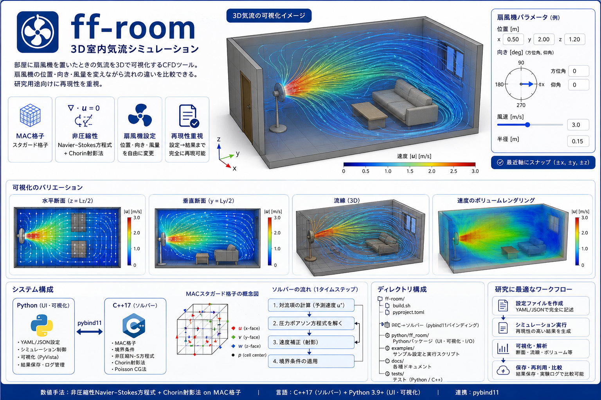

# ff-room: 3D室内気流シミュレーション

部屋に扇風機を置いたときの気流を3Dで可視化するCFDツール。
扇風機の位置・向き・風量を変えながら流れの違いを比較できる。研究用途向けに再現性を重視。

**数値手法**: 非圧縮性Navier-Stokes方程式 + Chorin射影法 on MAC格子  
**言語**: C++23 (ソルバー) + Python 3.11〜3.15 (UI・可視化)<br>
**連携**: pybind11


## 目次

- [インストール](#インストール)
- [クイックスタート](#クイックスタート)
- [設定ファイル](#設定ファイル)
- [可視化](#可視化)
- [結果の保存と再利用](#結果の保存と再利用)
- [実験ログ](#実験ログ)
- [ディレクトリ構成](#ディレクトリ構成)
- [テスト実行](#テスト実行)
- [ドキュメント一覧](#ドキュメント一覧)


## インストール

### 前提条件

| ツール | バージョン |
|--------|-----------|
| Python | >= 3.11 (最新安定版: 3.15.1) |
| C++ コンパイラ | C++23対応 (GCC 13+ / Clang 17+ / 現行MSVC) |
| CMake | >= 3.26 (4.x対応) |
| pybind11 | >= 3.1.0 (自動DL可) |

公開済みの最新C++規格は [C++23](https://isocpp.org/std/the-standard)。
Pythonは [3.15系](https://www.python.org/downloads/) に対応し、CIで3.11〜3.15の
wheelビルド・インストール・C++拡張の実行を確認する。

### 手順

```bash
# 推奨: 使用するPythonで仮想環境を作成
python3 -m venv .venv
source .venv/bin/activate
python -m pip install --upgrade pip

# C++拡張とPythonパッケージをインストール
python -m pip install -e ".[dev]"

# 3D表示・VTK出力を使う場合 (VTKが対応するPython環境)
python -m pip install -e ".[viz]"
```

PyVista/VTKはオプションの `viz` に分離した。2026年10月時点で
[VTKの配布wheel](https://pypi.org/project/vtk/#files) はPython 3.14までのため、
Python 3.15では標準のmatplotlibバックエンドで2D可視化・GIF出力を利用できる。
3D表示・VTK出力が必要な場合はPython 3.14で `.[viz]` をインストールする。

手動でビルドする場合:

```bash
python -m pip install 'pybind11>=3.1.0' 'cmake>=3.26' numpy pyyaml matplotlib
bash build.sh
export PYTHONPATH="$PWD/python${PYTHONPATH:+:$PYTHONPATH}"
```

`build.sh` は `cpp/build/` でcmakeを走らせ、生成した `_ffroom_core*.so` を
`python/ff_room/` にインストールする。
使用するPythonは `PYTHON_EXECUTABLE`、有効なvenv、conda、PATHの順に選択する。
別のPythonへ切り替える際は `cpp/build/` を削除してから再ビルドする。


## クイックスタート

```bash
# サンプル実行 (ビルド後)
python examples/run_basic.py
```

コードから使う場合:

```python
from ff_room import SceneConfig, SolverBridge, Visualizer

# 設定ファイル読み込み
config = SceneConfig.load_yaml("examples/basic_room.yaml")

# シミュレーション実行
result = SolverBridge(config).run(print_interval=50)
print(f"収束: {result.converged}, ステップ数: {result.steps}")

# 可視化
viz = Visualizer(result)
viz.multi_panel()          # 2×2パネル (断面×3 + 流線)
viz.streamlines()          # 3D流線
viz.slice_xz(y_frac=0.5)  # 中央垂直断面
```


## 設定ファイル

YAML形式 (JSONも可)。設定ファイルから**完全に**再現できることを保証する。

```yaml
metadata:
  name: my_experiment
  description: 説明を書く
  author: ""
  date: ""

room:
  size: [5.0, 4.0, 2.5]   # 部屋サイズ Lx, Ly, Lz [m]
  grid: [25, 20, 12]       # 格子分割数 Nx, Ny, Nz

fans:
  - name: fan0
    position: [0.5, 2.0, 1.2]   # 扇風機中心座標 [m]
    direction: [0.0, 0.0]        # [方位角_deg, 仰角_deg]
    velocity: 3.0                 # 吹き出し風速 [m/s]
    radius: 0.15                  # 羽根の外半径 [m]

obstacles:
  - name: sofa
    bbox_min: [2.0, 0.5, 0.0]   # 直方体下端 [m]
    bbox_max: [3.0, 1.8, 0.9]   # 直方体上端 [m]

solver:
  dt: 0.01                # タイムステップ [s]
  max_steps: 500          # 最大反復回数
  convergence_tol: 1.0e-4 # 収束判定 (max |Δu| / dt)
  rho: 1.2                # 空気密度 [kg/m³]
  nu: 1.5e-5              # 動粘度 [m²/s]
  poisson_max_iter: 1000  # Poisson CG最大反復
  poisson_tol: 1.0e-6     # Poisson収束閾値
```

### 扇風機の向き

| direction | 意味 |
|-----------|------|
| `[0, 0]`   | +x 方向 (東) |
| `[90, 0]`  | +y 方向 (北) |
| `[180, 0]` | -x 方向 (西) |
| `[270, 0]` | -y 方向 (南) |
| `[0, 90]`  | 上向き (+z) |
| `[0, -90]` | 下向き (-z) |

`[45, 15]` のような斜め方向も指定でき、円形の吹出口の面も同じ向きに傾く。

### 扇風機の吹き出しモデル

標準の `model: disk` は円形の吹出口を使う。中心のモーター部分と外周で風速を弱め、
羽根のある環状部分に速度分布を与える。projection・LBMの両ソルバーで利用できる。

```yaml
fans:
  - name: circulation_fan
    position: [0.5, 2.0, 1.2]
    direction: [30, 10]
    radius: 0.20
    model: disk
    hub_ratio: 0.20         # 中心部の半径 / 羽根外半径
    profile: annular       # 中心・外周で弱まる分布 (uniformも選択可)
    flow_rate: 0.30        # m³/s = 18 m³/min。指定時はvelocityより優先
    swirl_ratio: 0.15      # 旋回の強さ。0は旋回なし、負値で逆回転
```

`velocity` は羽根の環状部分の平均軸方向速度。`flow_rate` は
`π radius² (1 - hub_ratio²) × velocity` で換算する公称値で、格子上の実流量には
離散化・障害物の影響がある。直径を少なくとも4セル、分布の比較には8セル以上で
解像する。粗い格子では警告し、吹出口を表現できない場合はエラーにする。

従来の四角い一様送風は `model: patch` で選択できる。既存YAMLも読み込めるが、
`model` を省略した場合は新しい円形モデルを使うため、以前の結果の再現には `patch` を指定する。
詳細と近似の範囲は [数値モデルの仮定](docs/model_assumptions.md#5-扇風機モデルの近似) を参照。

### 座標系

```
z (高さ・上)
│
│   y (奥行き・北)
│  /
│ /
└──── x (横・東)

原点: 部屋の南西床角 (0, 0, 0)
```


## 可視化

```python
from ff_room import Visualizer

viz = Visualizer(result)

# --- 断面スライス viz.slice_xy(z_frac=0.5)       # 水平断面 z=Lz/2
viz.slice_xz(y_frac=0.5)       # 垂直断面 y=Ly/2
viz.slice_yz(x_frac=0.5)       # 横断面   x=Lx/2

# z_frac=0.0〜1.0 で断面位置を変える
viz.slice_xy(z_frac=0.48)      # ほぼ床面近く

# --- 流線 viz.streamlines(
    source_center=(0.5, 2.0, 1.2),  # 種点の中心 (省略時: 最初の扇風機)
    n_points=50,
    max_time=50.0,
)

# --- ボリュームレンダリング viz.volume_speed()

# --- 2×2まとめパネル viz.multi_panel()
```

PyVistaウィンドウ: マウスドラッグで回転、スクロールでズーム。


## 結果の保存と再利用

```python
from ff_room.io import ResultStore

# 保存
ResultStore.save_npz(result, "results/run1.npz")         # NumPy圧縮
ResultStore.save_vtk(result, "results/run1.vts")          # ParaView用VTK
ResultStore.save_velocity_csv(result, "results/run1.csv") # CSV (x,y,z,u,v,w,speed)

# 読み込んで再可視化
r2 = ResultStore.load_npz("results/run1.npz")
Visualizer(r2).multi_panel()
```

### NumPy配列として取得

```python
import numpy as np

# 速度場 (各軸のface-centered)
u = result.u_field   # shape: (Nx+1, Ny, Nz)
v = result.v_field   # shape: (Nx, Ny+1, Nz)
w = result.w_field   # shape: (Nx, Ny, Nz+1)
p = result.p_field   # shape: (Nx, Ny, Nz)

# セル中心ベクトル場 (Nx, Ny, Nz, 3)
vel = result.velocity_cell_centered()
speed = result.velocity_magnitude()   # (Nx, Ny, Nz)

# 任意断面を自分で切る
mid_z = speed.shape[2] // 2
import matplotlib.pyplot as plt
plt.imshow(speed[:, :, mid_z].T, origin='lower')
plt.colorbar(label='speed [m/s]')
plt.show()
```


## 実験ログ

配置を変えながら複数回実行するとき、ログで比較できる。

```python
from ff_room.io import ExperimentLog

log = ExperimentLog("results/log.jsonl")

# 実行のたびにappend
hash1 = log.append(result1, notes="扇風機: 南壁側")
hash2 = log.append(result2, notes="扇風機: 中央")

# 全ログ読み込み
entries = log.load_all()
for e in entries:
    print(e["config_hash"], e["converged"], e["wall_time_s"], e["notes"])
```

ログはJSON Lines形式 (`.jsonl`)。設定の完全なスナップショットを含む。


## ディレクトリ構成

```
ff-room/
├── build.sh                        ← C++ビルドスクリプト
├── pyproject.toml                  ← pip installエントリポイント
│
├── cpp/
│   ├── CMakeLists.txt
│   ├── src/
│   │   ├── core/
│   │   │   ├── Grid.hpp/.cpp           ← MACスタガード格子
│   │   │   ├── PoissonSolver.hpp/.cpp  ← 共役勾配法
│   │   │   ├── BoundaryManager.hpp/.cpp← 境界条件
│   │   │   └── FluidSolver.hpp/.cpp    ← 射影法メインループ
│   │   └── bindings/
│   │       └── module.cpp              ← pybind11バインディング
│   └── tests/                          ← Catch2ユニットテスト
│
├── python/
│   ├── ff_room/
│   │   ├── config.py        ← RoomConfig, FanConfig, SceneConfig (YAML/JSON)
│   │   ├── scene.py         ← SceneConfig → C++オブジェクト変換
│   │   ├── solver_bridge.py ← SolverBridge → SimResult
│   │   ├── visualization.py ← Visualizer (PyVista)
│   │   └── io.py            ← ResultStore, ExperimentLog
│   └── tests/               ← pytestテスト
│
├── examples/
│   ├── basic_room.yaml      ← 単一扇風機サンプル
│   ├── two_fans.yaml        ← 向き合う扇風機サンプル
│   └── run_basic.py         ← サンプル実行スクリプト
│
└── docs/
    ├── model_assumptions.md ← 数値モデルの仮定・境界条件・参考文献
    ├── user_guide.md        ← ユーザーガイド (詳細)
    └── developer_guide.md   ← 開発者ガイド (拡張方法)
```


## テスト実行

### Python・C++連携テスト

```bash
python -m pip install -e ".[dev]"
python -m pytest -v
```

設定・後処理のみのテストは `test_config.py` と `test_postprocess.py`。
`test_native_core.py` はインストール済みのC++拡張、NumPyビュー、両ソルバーを検証する。

### C++ テスト (Catch2が必要)

```bash
cmake -S cpp -B cpp/build -DBUILD_TESTS=ON
cmake --build cpp/build --parallel 2
ctest --test-dir cpp/build --output-on-failure
```

Catch2 3はOSのパッケージマネージャなどで別途導入する。


## ドキュメント一覧

| ファイル | 内容 |
|---------|------|
| `docs/model_assumptions.md` | 数値モデルの仮定・境界条件・単位系・参考文献 |
| `docs/user_guide.md`        | 使い方詳細・パラメータ選び方・トラブルシューティング |
| `docs/developer_guide.md`   | アーキテクチャ・拡張方法・「○○したい場合はここを直す」 |
